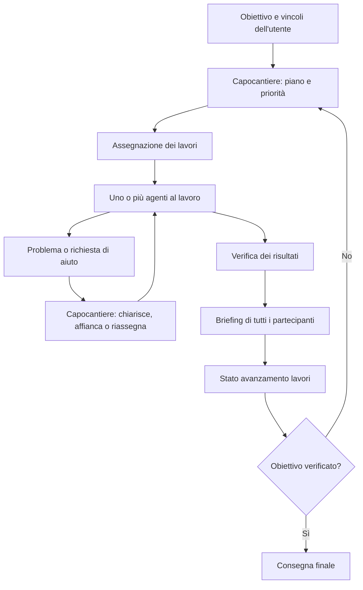

# Officina IA — specifica di adattamento

11 ottobre 2026. Proposta preparata dopo la richiesta di adattare una base
open source al lavoro con più assistenti. Base da valutare: Cezar; Maestro
rimane un candidato per confrontare l'esperienza grafica. Nessun fork o
adattamento eseguibile è stato realizzato in questa sessione.

## Il cantiere: ciclo di lavoro richiesto

Il capocantiere è l'agente coordinatore scelto per il progetto. Traduce
l'obiettivo dell'utente in fasi, assegna compiti, segue i problemi e decide
da dove ripartire. L'app conserva lo stato e applica le regole di esecuzione;
la sola conversazione del coordinatore non deve essere l'unica memoria.

### Preparazione e assegnazione

Ogni incarico specifica risultato atteso, contesto, dipendenze, responsabile,
ambito di modifica e prove richieste. Un lavoro può avere un solo esecutore
oppure un responsabile con collaboratori su parti distinte. Il capocantiere
avvia insieme le attività indipendenti e attende le dipendenze necessarie
per quelle successive. Cambiando il piano, registra il motivo della scelta.

### Sorveglianza e aiuto durante i lavori

Il capocantiere riceve risultati intermedi, domande, errori e indisponibilità.
L'app distingue processo vivo, attività in corso e avanzamento verificato:
un agente che produce molti messaggi non ha necessariamente fatto progressi.
In caso di problema il coordinatore può chiarire l'incarico, chiedere una
seconda opinione, affiancare un agente o riassegnare il compito, trasferendo
le evidenze già raccolte. Se serve una decisione dell'utente, il blocco resta
visibile; possono proseguire le attività che non dipendono da quella decisione.

### Briefing a fine fase

Terminata o arrestata una fase, il capocantiere convoca tutti gli agenti
che vi hanno partecipato, inclusi revisori e agenti con lavori bloccati.
Ognuno riporta:

- risultato e prove disponibili;
- problemi incontrati, incertezze e parti ancora da verificare;
- osservazioni sul lavoro degli altri, con riferimenti concreti;
- suggerimenti per la fase successiva.

Il capocantiere raccoglie tutte le opinioni, individua le divergenze e
richiede una verifica quando sono rilevanti. Un agente indisponibile è
segnalato come contributo mancante; il verbale non dichiara un briefing
completo né consenso unanime. Alla ripresa si può raccogliere quel contributo.
L'accordo del gruppo non sostituisce le prove di accettazione.

### Stato avanzamento lavori e nuova fase

Il verbale persistente elenca attività accettate, da correggere, in verifica,
bloccate e ancora da iniziare; collega risultati e opinioni dei partecipanti.
Registra decisioni del capocantiere, motivazioni, priorità e prossime
assegnazioni. Il conteggio dei compiti completati è distinto dall'eventuale
stima dell'avanzamento del progetto: non si inventa una percentuale dalla
quantità di messaggi o di test passati.

Il capocantiere riparte da dipendenze, gravità dei difetti, valore per
l'utente e disponibilità degli agenti. L'obiettivo e i vincoli dell'utente
restano il riferimento anche quando il gruppo suggerisce altre attività.

## Specializzazioni e scelta degli agenti

Ogni agente ha un profilo modificabile per capacità, ruoli preferiti,
strumenti disponibili e disponibilità del servizio. Le preferenze iniziali
sono scelte dell'utente; le assegnazioni successive possono tenere conto
di risultati verificati su compiti comparabili. Non si assume una classifica
universale fra modelli o che le capacità restino identiche fra versioni.

| Profilo iniziale | Impiego proposto |
|---|---|
| Capocantiere | Piano, assegnazioni, sorveglianza, briefing e stato avanzamento |
| Codex e Claude | Implementazione e revisione incrociata, con incarichi espliciti |
| Gemini | Contenuti, testi dell'interfaccia, documentazione e presentazione, secondo la preferenza dell'utente |
| Collaudatore | Riproduzioni, prove eseguibili, log e verifica dei criteri di accettazione |

Questi sono ruoli di progetto, non attestazioni delle capacità dei modelli.
Il capocantiere può essere cambiato; lo stato della fase e le decisioni
devono essere disponibili al sostituto. Per Gemini rimane da verificare
l'adattatore e lo strumento di accesso prima di dichiararlo integrato.

## Ostacoli e risposte progettuali

Questa tabella raccoglie problemi osservabili nel lavoro sugli stessi
sorgenti. La loro frequenza e il vantaggio delle soluzioni vanno misurati.

| Ostacolo | Risposta | Criterio di accettazione |
|---|---|---|
| Ricostruire ciò che l'altro ha fatto | Stato condiviso di compiti, decisioni e prove | Un nuovo agente ritrova obiettivo, vincoli e ultimo risultato |
| Modificare codice superato | Ogni incarico indica revisione e manifest dei file | Un risultato su una base cambiata è segnalato prima dell'integrazione |
| Attendere un chiarimento tramite l'utente | Domande indirizzate agli agenti con scadenza e risposta correlata | Domanda e risposta raggiungono i destinatari senza copia-incolla |
| Sovrascrivere modifiche concorrenti | Worktree distinti e responsabilità esplicite sui file | Conflitti rilevati prima dell'integrazione; nessuna modifica persa |
| Ripetere una prova invariata | Risultati associati a codice, ambiente e comando | Riutilizzo soltanto se tutte le dipendenze rilevanti coincidono |
| Continuare senza avanzare | Registrazione dei tentativi e controllo dei cicli | Il coordinatore segnala il blocco e cambia strategia |
| Esaurire la disponibilità di un provider | Salvataggio dello stato e riassegnazione esplicita | Il sostituto riceve contesto ed evidenze senza dichiarare concluso il compito |
| Leggere resoconti troppo lunghi | Sintesi per destinatario con collegamenti alle prove | Ogni affermazione rilevante resta rintracciabile nel risultato originale |

## Stato comune e comunicazione

Ogni compito registra obiettivo, criteri di riuscita, dipendenze, base di
codice, responsabile, stato e riferimenti agli artefatti. Stati proposti:
pronto, in corso, in attesa di risposta, bloccato, in verifica, concluso.
Un turno terminato non implica un compito concluso.

Ogni messaggio ha identificatore, mittente, destinatario, compito, tipo,
data e riferimento alla domanda o al risultato cui risponde. Tipi iniziali:
domanda, risposta, ipotesi, risultato, blocco, richiesta di revisione.
Consegna e presa in carico sono eventi distinti. Dopo un arresto si
riconsegnano i messaggi pendenti senza ripetere le azioni già registrate.

Il coordinatore inoltra soltanto il contesto utile. Le risposte degli altri
agenti sono contributi da verificare; non modificano l'obiettivo o i vincoli
stabiliti dall'utente. Le ipotesi restano riconoscibili come tali finché una
prova non le conferma.

## Cosa riusare di Cezar

Alla revisione esaminata esistono deleghe, worktree, rapporti persistenti,
caselle fra agenti e notifiche al coordinatore. Il contratto include
evidenze, errori, stato bloccato e verdetti di revisione.
[Contratto](https://github.com/open-mercato/cezar/blob/d19fc42ee3b3e52aeb594b983c9969c68e170114/packages/contract/src/dispatch.ts),
[caselle dei messaggi](https://github.com/open-mercato/cezar/blob/d19fc42ee3b3e52aeb594b983c9969c68e170114/packages/cezar/src/dispatch/tree-fs.ts).

Da verificare prima di aggiungere codice: recupero dopo arresto, messaggi
duplicati, tempi di consegna, vincoli effettivi sui file e compatibilità
dei vari strumenti. Un vincolo scritto nel prompt non costituisce da solo
un controllo sulle operazioni eseguite.

## Collegamento degli agenti

L'app deve usare adattatori separati per ogni strumento, con un contratto
comune: avvio, ripresa, messaggio, interruzione, stato, risultato ed errore.
Le capacità disponibili sono dichiarate dall'adattatore; l'interfaccia
non promette funzioni che un provider non espone.

Per Codex è disponibile l'App Server con protocollo bidirezionale:
creazione/ripresa di conversazioni, avvio dei turni, aggiornamenti durante
un turno e interruzione. Propongo il trasporto locale stdio per il primo
adattatore. L'integrazione non è stata implementata né provata con richieste
a un modello.
[Documentazione ufficiale OpenAI](https://learn.chatgpt.com/docs/app-server).

Verifica locale eseguita: `codex --version` riporta **0.162.1**;
`codex app-server --help` espone l'App Server e stdio. Questo conferma
la presenza del comando, non l'autenticazione o l'accesso ai modelli.

## Interfaccia proposta

- Vista dei compiti, con dipendenze e responsabili.
- Conversazione del gruppo con domande, risposte e decisioni rintracciabili.
- Scheda per agente: compito, strumento, stato e causa dell'eventuale blocco.
- Pannello delle prove: comando, risultato, base verificata e artefatti.
- Revisione della modifica da integrare e confronto con i criteri richiesti.
- Arresto del gruppo che interrompe il lavoro senza cancellare i risultati.
- Vista «Cantiere» con fase corrente, capocantiere, incarichi e blocchi.
- Briefing con il contributo di ogni partecipante e divergenze aperte.
- Stato avanzamento lavori e motivazioni delle prossime assegnazioni.
- Profili delle specializzazioni modificabili dall'utente.

## Primo collaudo

Repository temporaneo, piccolo difetto riproducibile, implementatore e
revisore di strumenti diversi. Verificare nell'ordine:

1. Assegnazione e chiarimento fra agenti senza intervento dell'utente.
2. Un difetto segnalato dal revisore viene corretto e la prova ripetuta.
3. Un messaggio duplicato non crea un secondo compito o una seconda azione.
4. Arresto durante un compito, riavvio e recupero del risultato pendente.
5. Provider non disponibile: blocco esplicito e passaggio del compito.
6. Due modifiche incompatibili: conflitto visibile, base conservata.
7. Fine fase: ogni partecipante contribuisce al briefing, anche se bloccato.
8. Un'opinione contraria viene conservata e produce una verifica quando serve.
9. Il coordinatore genera lo stato avanzamento e assegna la fase successiva
   rispettando dipendenze e preferenze di ruolo.
10. Cambio del capocantiere: il sostituto ritrova incarichi, decisioni e
    contributi senza ripetere il lavoro già accettato.

Misurare tempi di consegna, ripetizioni inutili, errori di recupero e consumo
riportato. I tempi del trasporto e quelli di risposta del modello si
registrano separatamente. I limiti operativi si configurano con l'utente;
non si presume che più parallelismo migliori ogni attività.

La prova del desktop Liquid userà successivamente sessioni Wayland private,
con responsabilità esclusiva su mouse e tastiera. Il passaggio a Liquid
richiede una base contenente anche le modifiche locali e una scelta esplicita
sulle operazioni Git consentite secondo `audit/README.md`.

## Ordine di lavoro

1. Riprodurre il collaudo sulle capacità già presenti nella base scelta.
2. Registrare le lacune effettive.
3. Implementare consegna, recupero e verifiche mancanti.
4. Adattare l'interfaccia al nostro flusso quotidiano.
5. Collegare le prove di Liquid e generare automaticamente il diario audit.

Le condizioni di riuscita restano evidenze e risultati ripetibili. Il
coordinamento può ridurre lavoro perso e attese; non garantisce che gli
agenti eliminino errori o limiti dei modelli.
