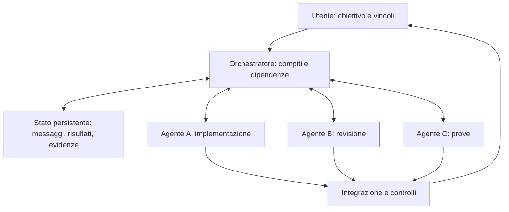

# Orchestrazione di più IA per Liquid DE

Ricerca dell'11 ottobre 2026. Scopo: assegnare compiti a più assistenti,
scambiare domande e risultati automaticamente e conservare il lavoro fra
sessioni. La valutazione riguarda documentazione e lettura mirata del codice;
non è una certificazione del funzionamento sul nostro desktop.

## Scelta proposta

**Maestro per provare subito la collaborazione; Cezar come prima base da
valutare se serve una nostra applicazione.** Sono giudizi di aderenza alle
nostre esigenze. Esistono già progetti adatti: prima di sviluppare un fork,
conviene verificare con una prova pratica quali capacità mancano davvero.

| Progetto | Cosa offre | Limite per il nostro uso |
|---|---|---|
| [Maestro](https://github.com/RunMaestro/Maestro) | App desktop, diversi agenti, conversazioni coordinate | La ripresa delle deleghe dopo un arresto va verificata |
| [Cezar](https://github.com/open-mercato/cezar) | Compiti paralleli, deleghe, messaggi fra agenti, interfaccia web | Consegna dei messaggi alle transizioni dei turni: tempi e recupero da verificare |
| [Stoneforge](https://github.com/stoneforge-ai/stoneforge) | Pianificazione, dipendenze, messaggi persistenti, integrazione automatica | Sperimentale; impostazioni autonome incompatibili con le nostre regole attuali |

## 1. Maestro: il candidato per la prima prova

Maestro supporta Claude Code, Codex e OpenCode, oltre ad altri strumenti;
dispone di distribuzioni Linux e codice AGPL-3.0. La pagina delle release
riporta la versione 1.0.0 del 9 ottobre 2026.
[Repository](https://github.com/RunMaestro/Maestro),
[release](https://github.com/RunMaestro/Maestro/releases).

La Group Chat sceglie un moderatore che coinvolge gli agenti, pone domande
successive e riassume i risultati. I partecipanti non ricevono automaticamente
tutte le risposte degli altri: è il moderatore a inoltrare il contesto utile.
L'opzione predefinita attende gli agenti occupati; disabilitarla può far
scrivere due processi sugli stessi file.
[Funzionamento della Group Chat](https://docs.runmaestro.ai/group-chat).

Le menzioni fra agenti permettono consultazioni parallele. Le cartelle Git
separate permettono di lavorare su rami distinti, evitando la sovrascrittura
diretta degli stessi file; restano possibili conflitti quando si integrano
le modifiche.
[Consultazioni](https://docs.runmaestro.ai/cross-agent-mentions),
[worktree](https://docs.runmaestro.ai/git-worktrees).

La CLI offre `dispatch --notify-on-complete`: al termine del compito viene
avviato un turno nell'agente chiamante con risultato e riferimento al
resoconto completo. La documentazione dichiara però che queste notifiche
pendenti non sopravvivono al riavvio dell'app. La persistenza della coda
della chat è una capacità distinta.
[CLI e notifiche](https://docs.runmaestro.ai/cli#dispatch-with-callback---notify-on-complete).

Ho letto il registro delle notifiche e la gestione del moderatore alla
revisione `34fcf98d798a3201b0e79f12ae203d79bf3e3291`. Il registro usa
strutture in memoria e le svuota in `dispose()`; questa lettura conferma
il limite documentato, senza dimostrare l'intero comportamento a runtime.
[Codice esaminato](https://github.com/RunMaestro/Maestro/blob/34fcf98d798a3201b0e79f12ae203d79bf3e3291/src/main/dispatch-callbacks/dispatch-callback-registry.ts).

## 2. Cezar: base interessante per un'app nostra

Cezar è MIT, coordina diversi strumenti di coding tramite le loro CLI e
offre una dashboard locale. Ogni compito ha un worktree; un agente può
delegare sotto-compiti e ricevere i risultati nella propria sessione.
I flussi possono alternare agenti, comandi di verifica e tentativi limitati.
Il progetto dichiara che l'integrazione non avviene automaticamente.
[Repository e flussi](https://github.com/open-mercato/cezar).

Alla revisione `d19fc42ee3b3e52aeb594b983c9969c68e170114`, il motore di
delega calcola il budget residuo del genitore considerando i figli,
prepara incarichi con criteri di successo ed evidenze richieste, e genera
un rapporto anche se un figlio termina senza scriverlo. I risultati
pendenti sono conservati sullo stato del genitore. Un budget non impostato
rimane senza tetto; i costi riportati dipendono dai dati del provider.
[Motore esaminato](https://github.com/open-mercato/cezar/blob/d19fc42ee3b3e52aeb594b983c9969c68e170114/packages/cezar/src/dispatch/engine.ts).

Salvare lo stato su file internamente non richiede all'utente di fare da
messaggero. Il punto da verificare è la consegna automatica dei messaggi e
la ripresa corretta del lavoro.

### Approfondimento dopo la richiesta di adattamento

Il modulo `tree-fs.ts` contiene caselle indirizzabili anche fra agenti dello
stesso gruppo, non soltanto dal figlio al genitore. Il motore è descritto
come responsabile della scansione a fine turno e della riattivazione dei
destinatari in attesa; all'apertura della sessione prepara un riepilogo
dei nuovi messaggi. Questo corregge la valutazione iniziale, limitata alle
deleghe. La consegna end-to-end non è ancora stata provata.
[Modulo dei messaggi esaminato](https://github.com/open-mercato/cezar/blob/d19fc42ee3b3e52aeb594b983c9969c68e170114/packages/cezar/src/dispatch/tree-fs.ts).

Il contratto dei rapporti prevede stati di blocco, evidenze, errori,
suggerimenti e verdetti di revisione. Il consumo viene controllato fra i
turni: non deduco da ciò un tetto esatto alla spesa di una richiesta già
avviata.
[Contratto esaminato](https://github.com/open-mercato/cezar/blob/d19fc42ee3b3e52aeb594b983c9969c68e170114/packages/contract/src/dispatch.ts).

Le istruzioni di delega richiedono un commit prima della creazione dei
figli e consentono al genitore di integrare i rami dei figli nel proprio
ramo di lavoro. Il controllo dell'integrazione nella base è distinto da
queste operazioni. Prima di un uso operativo occorre conciliarle con le
regole Git di Liquid; la prova iniziale va preparata in un progetto isolato.
[Istruzioni di delega esaminate](https://github.com/open-mercato/cezar/blob/d19fc42ee3b3e52aeb594b983c9969c68e170114/packages/cezar/src/dispatch/prompts.ts).

La [specifica di adattamento](officina-ia-specifica.md) traduce gli ostacoli
di lavoro in funzioni e criteri di verifica.

## 3. Stoneforge: architettura completa, da adattare

Stoneforge separa Director, Worker e Steward: pianificazione, esecuzione
in worktree e revisione/integrazione. Include messaggi e stato persistente,
supporta Claude Code, OpenCode e Codex ed è Apache-2.0. Il README lo
definisce sperimentale e dichiara che gli agenti partono con permessi
di approvazione aggirati, anche per operazioni sul codice remoto.
Questo comportamento contrasta con `audit/README.md`, dove commit e push
richiedono la decisione dell'utente.
[Repository](https://github.com/stoneforge-ai/stoneforge).

Ho letto parte del demone di assegnazione alla revisione
`0a7052a9ffa1fb42fafbff9d9b6b83fa48cdad95` e il ciclo documentato di
recupero/assegnazione. È utile come riferimento architetturale; prima di
usarlo qui andrebbero modificati e provati i vincoli di integrazione.
[Ciclo di orchestrazione](https://github.com/stoneforge-ai/stoneforge/blob/0a7052a9ffa1fb42fafbff9d9b6b83fa48cdad95/apps/docs/src/content/docs/core-concepts/orchestration-loop.mdx).

[AgentPilot](https://github.com/jbexta/AgentPilot) è un'ulteriore alternativa
con editor grafico di flussi e agenti paralleli, AGPL-3.0. Per il nostro caso
la documentazione esaminata offre meno elementi sull'integrazione Git
coordinata: lo terrei come riferimento per l'interfaccia.

## Prova pilota proposta

La prima prova deve misurare la collaborazione, con un compito piccolo e
ripetibile in un repository temporaneo. Criteri di riuscita:

1. L'orchestratore assegna due attività indipendenti a strumenti diversi.
2. Un agente chiede un chiarimento e riceve la risposta senza copia-incolla.
3. Un revisore trova un difetto riprodotto da una prova e il correttore lo risolve.
4. La chiusura di un processo restituisce un errore o un blocco riconoscibile.
5. Riavviando l'app, nessun risultato viene perso o consegnato due volte.
6. Modifiche, prove eseguite e consumo riportato restano consultabili.
7. L'integrazione produce una modifica esaminabile e rispetta le regole Git.

Prima di usare Liquid serve una base che includa il lavoro locale corrente:
un worktree creato dal solo commit di partenza non include le modifiche
non committate né i file nuovi. Una copia isolata con manifest dei file
permette di preparare questa base senza pubblicare il lavoro.

## Se la prova evidenzia lacune: proposta «Officina IA»

Il nome è provvisorio. Questa è una proposta, non un'app già implementata.

Funzioni da aggiungere soltanto se mancanti nella base scelta:

- Messaggi strutturati: domanda, ipotesi, risultato, richiesta di revisione,
  blocco; riferimenti a file e prove anziché intere conversazioni duplicate.
- Dipendenze fra compiti, responsabilità su file e revisione indipendente.
- Limiti di costo, durata e parallelismo; arresto di cicli ripetitivi;
  passaggio del compito quando un provider esaurisce la disponibilità.
- Ripresa persistente con identificatori dei messaggi e deduplicazione.
- Prove del desktop in sessioni Wayland private, con log e schermate;
  coordinamento esclusivo di chi usa mouse e tastiera.
- Registro giornaliero generato dai risultati, mantenendo il formato audit.

Gli agenti devono poter dichiarare «non verificato», chiedere aiuto e
confrontare ipotesi con prove eseguibili. Più agenti non garantiscono una
risposta corretta: la verifica indipendente resta il criterio di accettazione.

## Stato al termine della ricerca

Nessuno degli orchestratori è stato installato o avviato in questa sessione.
Non sono state lanciate richieste a modelli attraverso questi progetti.
Le sessioni dovranno ricevere il contesto del lavoro e disporre di strumenti
autenticati; l'orchestratore non trasferisce automaticamente questa chat
né rimuove i limiti dei servizi utilizzati.

Gli estratti di codice con revisioni e fonti sono conservati nel repository
di prove, in `rapporti/orchestrazione-ia-2026-10-11/`.
